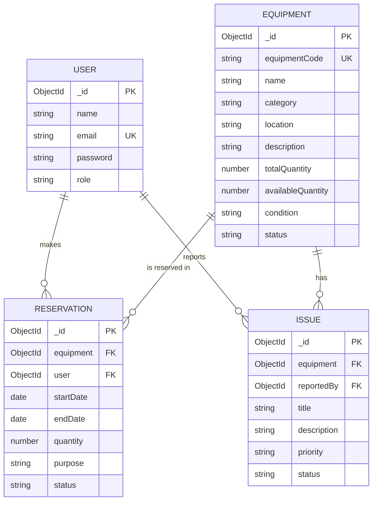

# Smart Lab - Laboratory Equipment Management System

Smart Lab is a small MERN stack (MongoDB, Express, React, Node.js) web application for a university lab.
Students can look at the lab equipment and request reservations. Lab staff (technicians and the admin) manage
the equipment list, approve reservations and handle problem reports.

## Main entity and CRUD

The main entity is **Equipment**. All CRUD operations work and the data is saved in MongoDB.

| Operation | What can be done |
|---|---|
| Create | Add new equipment using a form (admin, technician) |
| Read | List, view details, search, filter by category/status, sort (all users) |
| Update | Edit equipment details (admin, technician) |
| Delete | Delete equipment (admin only). Blocked if it still has pending/approved reservations or open issues |

Reservations and Issues also have create / read / update / delete. Users can be managed by the admin.

## User roles (3 logins) with samples

| Role | Email | Password | What they can do |
|---|---|---|---|
| Admin | admin@smartlab.lk | Admin@123 | Everything: equipment CRUD, approve reservations, manage issues, manage users |
| Technician | tech@smartlab.lk | Tech@123 | Add/edit equipment, approve or reject reservations, update issue status |
| Student | student@smartlab.lk | Student@123 | View equipment, make/edit/delete own pending reservations, report issues |

New students can also register using the Register page.

## Technologies

- Frontend: React (Vite), React Router, Axios, plain CSS
- Backend: Node.js, Express
- Database: MongoDB with Mongoose
- Login: JWT token and bcryptjs password hashing

## Folder structure

```
smart-lab
|-- client            React frontend
|   `-- src
|       |-- components    Navbar
|       |-- pages         Login, Register, Dashboard, Equipment, Reservations, Issues, Users
|       |-- api.js        Axios setup
|       `-- styles.css
|-- server            Express backend
|   |-- models            User, Equipment, Reservation, Issue (Mongoose)
|   |-- routes            auth, equipment, reservations, issues, users, stats
|   |-- middleware        auth.js (login + role check)
|   |-- seed.js           sample data
|   `-- server.js
`-- docs              ERD and screenshots
```

## How to run (VS Code)

### 1. Requirements
- Node.js 18 or newer (check with `node -v`)
- MongoDB - choose ONE:
  - **Local:** MongoDB Community Server (and MongoDB Compass to see the data), or
  - **Cloud:** a free MongoDB Atlas cluster

### 2. Install packages
Open the project folder in VS Code, open a terminal (Ctrl + `) and run:

```bash
cd server
npm install
cd ../client
npm install
```

### 3. Set the database connection
The file `server/.env` is already set for a local MongoDB:

```
PORT=5000
MONGO_URI=mongodb://127.0.0.1:27017/smart_lab_db
JWT_SECRET=smartlab_secret_key_123
```

If the file is missing, copy `server/.env.example` to `server/.env`.
To use Atlas, replace `MONGO_URI` with your Atlas connection string and add the database name before the `?`
(for example `...mongodb.net/smart_lab_db?retryWrites=true&w=majority`).

### 4. Add sample data
Make sure MongoDB is running, then:

```bash
cd server
npm run seed
```

This creates the 3 demo logins, 6 equipment items, reservations and issues.
(It clears the old data of this database first.)

### 5. Start the backend (terminal 1)
```bash
cd server
npm run dev
```
You should see `MongoDB connected: smart_lab_db` and `Server running on http://localhost:5000`.

### 6. Start the frontend (terminal 2)
```bash
cd client
npm run dev
```
Open **http://localhost:5173** in the browser and login with one of the demo accounts.

## Viewing the data in MongoDB

Using **MongoDB Compass**: click *New Connection*, paste `mongodb://127.0.0.1:27017` (or your Atlas string),
connect, then open the database `smart_lab_db`. The collections are `users`, `equipment`, `reservations`, `issues`.
Changes made in the website (add, edit, delete) appear here after pressing the refresh button.

## Database design

Four collections. Relationships use ObjectId references.




## Validation and error handling

Client side (React):
- required fields on all forms, email format, password length, password confirmation
- available quantity cannot be more than total quantity
- reservation end date must be after the start date

Server side (Express + Mongoose):
- required fields, allowed values (enum) for category, status, role, condition
- unique equipment code and unique email
- reservation quantity must not be more than the available quantity, dates cannot be in the past
- login token check and role check for every protected route
- clear error messages are returned and shown on the page (the server does not crash on bad input)

## API summary

| Method | URL | Who |
|---|---|---|
| POST | /api/auth/register, /api/auth/login | everyone |
| GET | /api/equipment?search=&category=&status=&sort= | logged in |
| POST, PUT | /api/equipment, /api/equipment/:id | admin, technician |
| DELETE | /api/equipment/:id | admin |
| GET, POST | /api/reservations | GET: logged in, POST: student |
| PUT | /api/reservations/:id (edit), /api/reservations/:id/status | student, staff |
| DELETE | /api/reservations/:id | student (own pending), admin |
| GET, POST | /api/issues | logged in |
| PUT, DELETE | /api/issues/:id | staff, admin |
| GET, PUT, DELETE | /api/users | admin |
| GET | /api/stats | logged in |


## Common problems

- **`MongoDB connection failed` / `ECONNREFUSED`**: MongoDB is not running. Start the MongoDB service (or check the Atlas string and that your IP is allowed in Atlas Network Access).
- **Login says "Cannot reach the server"**: the backend is not running. Start it with `npm run dev` inside `server`.
- **Equipment list is empty / login fails**: run `npm run seed` inside `server`.
- **Port already in use**: change `PORT` in `server/.env` and the proxy line in `client/vite.config.js`.

## Notes

This project is for coursework only. The demo passwords are for demonstration.


Designed by,
R.M.P.M. Ratnayake